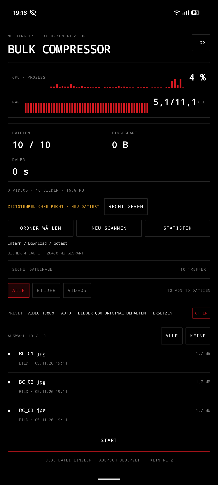
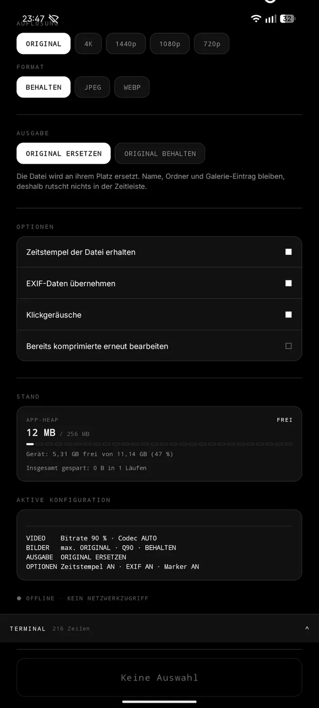
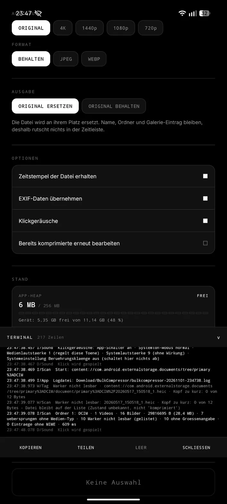

[](https://ko-fi.com/steimerbyte)
> ⭐ If you find this useful, consider [supporting me on Ko-fi](https://ko-fi.com/steimerbyte)!

# Bulk Compressor

<p align="center">
  <a href="https://github.com/steimerbyte/bulkcompressor/releases/latest"></a>
  <a href="https://github.com/steimerbyte/bulkcompressor/blob/master/LICENSE"></a>
  <a href="https://github.com/steimerbyte/bulkcompressor/releases"></a>
</p>

Nothing-OS-inspirierte Android-App, die einen **Ordner voller Videos und
Bilder** komprimiert — ohne die Galerie durcheinanderzubringen.

Der Kern der App ist nicht das Komprimieren, sondern das **Ersetzen**:
die Datei bleibt, wo sie war, behält ihren Namen und ihren Zeitstempel
und wird nur kleiner. Kein neuer Ordner, keine Dubletten, keine
umgekippte Chronologie.

Kein Konto. Kein Netzwerk. Keine Analytics. Kein `INTERNET`-Recht.

---

## Screenshots

| Übersicht | Optionen und Stand | Terminal |
|---|---|---|
|  |  |  |
| Ordner mit laufender Scan-Zeile, Video- und Bildpresets | Ausgabe, Optionen, Speicherstand, aktive Konfiguration | Protokoll aufgeklappt, mit Kopieren/Teilen/Leeren |

Aufgenommen mit **1.9.4**. Der Knopf **Statistik** unter der Stand-Tafel
kam mit 1.9.5 — er fehlt auf diesen Bildern noch.

---

## Inhalt

- [Was die App tut](#was-die-app-tut)
- [Ordner und Scan](#ordner-und-scan)
- [Auswahl](#auswahl)
- [Video](#video)
- [Bilder](#bilder)
- [Ausgabe](#ausgabe)
- [Optionen](#optionen)
- [Start, Dienst, Benachrichtigung](#start-dienst-benachrichtigung)
- [Terminal und Protokoll](#terminal-und-protokoll)
- [Stand und Statistik](#stand-und-statistik)
- [Zeitstempel und Chronologie](#zeitstempel-und-chronologie)
- [Marker, Wiederholung, Prüfung](#marker-wiederholung-prüfung)
- [Lange Läufe](#lange-läufe)
- [Threads](#threads)
- [Technik](#technik)
- [Berechtigungen](#berechtigungen)
- [Logdatei](#logdatei)
- [Installation](#installation)
- [Tests](#tests)
- [Release](#release)
- [Grenzen (ehrlich)](#grenzen-ehrlich)
- [Lizenz](#lizenz)

---

## Was die App tut

1. **Ordner wählen** über den Android-Systemdialog (Storage Access
   Framework). Die App bekommt dauerhaften Zugriff auf genau diesen
   Ordner und liest rekursiv Videos und Bilder heraus.
2. **Presets einstellen** (siehe [Video](#video) und [Bilder](#bilder)).
3. **Auswählen**, was bearbeitet wird — alles oder einzelne Dateien.
4. **Start.** Der Knopf ganz unten ist Start und Stopp in einem;
   alles Weitere läuft als Vordergrunddienst mit
   Fortschrittsbenachrichtigung, auch bei gesperrtem Bildschirm — über
   Stunden, mit Speicherbremse und ohne Verlust des Fortschritts (siehe
   [Lange Läufe](#lange-läufe)).

Das Protokoll zeigt pro Datei eine Zeile:

```
ERSETZT IMG_20240611_184210.jpg · 4,12 MB → 1,03 MB (25 %) · 4032x3024 · JPEG · EXIF
NEU      VID_20240603_101244.mkv · 812,44 MB → 168,10 MB (20 %) · 1920x1080 · H.264 (Encoder-Limit) · 2842 kbit/s
SKIP     IMG_20240501_090000.jpg: Ergebnis waere 2,10 MB statt 1,80 MB
```

`ERSETZT` = die Originaldatei wurde überschrieben, `NEU` = eine
zusätzliche Datei daneben.

**Nie überschrieben wird**, wenn das Ergebnis größer wäre als das
Original — dann steht dort `SKIP`. Ebenso, wenn die Einstellungen für
die Datei nichts ändern (z. B. „1080p" bei einem 720p-Video).

## Ordner und Scan

**Ordner wählen** öffnet den Systemdialog; die Freigabe bleibt über
Neustarts erhalten. Unter dem Ordnerpfad liegt die Knopfreihe
**Ordner wählen** / **Neu scannen**. Der zweite Knopf braucht keinen neuen
Dialog — der Freigabe-Token liegt vor, es geht nur um eine frische Liste.
Während eines Scans ist er gesperrt und sichtbar zurückgenommen: ein
zweiter Start würde den laufenden abbrechen und sähe wie ein Fehler aus.
Ist die Freigabe abgelaufen, steht das als Satz da („Ordnerzugriff
abgelaufen – bitte neu wählen") statt als leerer Bildschirm.

Der Pfad wird lesbar angezeigt („Intern / DCIM"), nicht als
`content://…`-URI.

Während des Scans:

- **Punktmatrix neben `ORDNER`** (`ScanBeacon`) läuft, solange gelesen
  wird; im Ruhezustand zeichnet sie nichts, behält aber ihren Platz, damit
  nichts springt. Ist im System „Animationen entfernen" gewählt, steht das
  Muster still.
- **Die Live-Zeile** unter der Zählerzeile läuft mit und nennt in jedem
  Durchgang, was gerade passiert: „517 Dateien · liest · Camera/IMG_0421.jpg",
  dann „517 Dateien · prüft 213/517 · Camera/IMG_0421.jpg" — die
  Marker-Prüfung ist der langsame Teil, und ohne diesen Bruch sah die App
  dort Minuten lang aus, als täte sie nichts. Gezählt wird, was **gefunden**
  ist, nicht was schon auf der Liste steht. Nach dem Scan verschwindet die
  Zeile; an ihrer Stelle steht die Zusammenfassung, und wenn Marker
  unlesbar waren, mit dem Grund („· 40 Marker nicht lesbar (Kopf nicht
  lesbar: FileNotFoundException …)").
- **Das Protokoll** bekommt eine Zeile je gelesenem Ordner
  (`Ordner 3: DCIM/Camera · 517 Eintraege`) und bei großen Ordnern alle 250
  geprüfte Marker eine Fortschrittszeile. Vorher schwieg es, bis der Ordner
  fertig war.
- **Der Scan endet immer mit einer Aussage**: „1 Ordner · 17 Dateien",
  „Keine Videos oder Bilder gefunden." oder „Ordner konnte nicht gelesen
  werden. Einzelheiten im Terminal."

Grenzen je Scan: **20 000 Dateien** und **2 000 Ordner**; wird eine
erreicht, sagt die Zusammenfassung „· Liste begrenzt". Nicht lesbare
Unterordner werden gezählt („· 4 Ordner nicht lesbar"), nicht verschwiegen.

Ordner ohne Verzeichnis-Typ erkennt der Scan am Kind-Abruf (siehe
[Grenzen](#grenzen-ehrlich)).

## Auswahl

Jede gefundene Datei steht als Zeile mit Name und Kurzinfo, davor ein
Griff `■`. Getippt wird umgeschaltet; **ALLE** und **KEINE** setzen die
ganze Liste. Über der Liste steht „N von M".

Nach einem Scan ist **alles ausgewählt** — der Normalfall ist „diesen
Ordner verkleinern", nicht „diese drei Bilder".

## Video

Drei Modi, ein Regler und zwei Chip-Reihen:

| Modus | Was er tut |
|---|---|
| **BITRATE** | Nur die Bitrate wird prozentual gesenkt, die Auflösung bleibt. |
| **AUFLÖSUNG** | Nur herunterskaliert, die Bitrate folgt dem Encoder. |
| **BEIDES** | Beides zusammen — der stärkste Effekt, sichtbarster Qualitätsverlust. |

Vorgabe beim ersten Start: **AUFLÖSUNG** bis 1080p, Bilder mit Q80 und
unveränderter Auflösung, Ausgabe „Original ersetzen". Alles danach wird
gemerkt und beim nächsten Start wiedergefunden.

**Bitrate:** 5–100 % der Quellbitrate, in 1-%-Schritten (Vorgabe 60 %).
Der Regler ist eine Schiene mit Punktskala: Schiene = Strecke, Punkte =
Wert, Knopf = Stellung. Die Prozentzahl steht in der Zeile **über** dem
Regler, nicht auf dem Knopf — sie wird von ihm nie verdeckt.

**Auflösung**, bezogen auf die *kurze* Kante — damit Hochformat nicht als
Querformat behandelt wird:

| Chip | kurze Kante | typisch |
|---|---|---|
| Original | — | unverändert |
| 4K | 2160 | 3840×2160 |
| 1440p | 1440 | 2560×1440 |
| 1080p | 1080 | 1920×1080 |
| 720p | 720 | 1280×720 |
| 480p | 480 | 854×480 |

Hochskaliert wird nie: ein 720p-Video bleibt bei „4K" einfach 720p.
Ungerade Kanten werden auf gerade Werte abgerundet, weil Encoder sonst
scheitern.

**Codec:** AUTO (Quellcodec beibehalten), H.264 oder H.265. H.265 ist bei
gleicher Bitrate besser, aber nicht jedes Gerät kann es; fehlt der
Encoder, fällt die App auf H.264 zurück und schreibt das ins Protokoll
(`H.264 (Encoder-Limit)`).

Ein Abschnitt, der nicht wirkt, sagt das einmal: „AUFLÖSUNG — INAKTIV",
wenn der Modus nur die Bitrate senkt, und die Chips treten sichtbar
zurück, statt so auszusehen, als könnte man sie antippen.

## Bilder

**Qualität:** 40–95 in 1-%-Schritten (Vorgabe 80).

**Auflösung:** Original, 4K, 1440p, 1080p, 720p — dieselbe Bedeutung der
kurzen Kante wie beim Video, ebenfalls ohne Hochskalieren.

**Format:** Behalten (JPEG bleibt JPEG, WebP bleibt WebP), **JPEG** oder
**WebP**.

## Ausgabe

| Modus | Ergebnis |
|---|---|
| **Original ersetzen** | Die Datei wird an derselben Stelle überschrieben. Name, Galerie-Eintrag und Pfad bleiben identisch — deshalb rutscht nichts in der Zeitleiste. |
| **Original behalten** | Neue Datei im selben Ordner mit Suffix `_compressed` (bzw. `_compressed_1`, `_compressed_2` … wenn es den Namen schon gibt). Originale bleiben unberührt. |

Unter den beiden Knöpfen steht, was der gewählte Modus bedeutet — nicht
als generischer Hilfetext, sondern als Folge für die eigene Galerie.

Manchmal ist „Original ersetzen" technisch nicht möglich, dann legt die
App **immer** eine neue Datei daneben, auch im Ersetzen-Modus:

* Video aus **MKV, WebM oder AVI** — der Encoder schreibt MP4, ein
  Überschreiben würde die Datei unbrauchbar machen. Aus `film.mkv` wird
  `film_compressed.mp4`.
* **HEIC/PNG → JPEG** oder **JPEG → WebP** — Endung und Inhalt müssten
  sich gemeinsam ändern, das kann SAF nicht.

Für MP4, M4V und MOV ist das Ersetzen unkritisch: das sind alles
MP4-Container.

## Optionen

Vier Schalter, gleiche Bauart, gleicher Block:

| Schalter | Vorgabe | Wirkung |
|---|---|---|
| **Zeitstempel der Datei erhalten** | an | Setzt die Änderungszeit der neuen Datei auf die Aufnahmezeit — über den Dateipfad, siehe [Zeitstempel](#zeitstempel-und-chronologie). |
| **EXIF-Daten übernehmen** | an | Kamera, Belichtung, GPS, Aufnahmezeit wandern in die neue Datei. |
| **Klickgeräusche** | an | Die Holz-Klicks und die Dauertöne (siehe [Technik](#technik)). |
| **Bereits komprimierte erneut bearbeiten** | aus | Ignoriert den Marker. Für den Fall, dass der erste Lauf zu schwach eingestellt war. |

Fehlt für den Zeitstempel das Recht „Zugriff auf alle Dateien", erklärt
die App **einen** Satz dazu und bietet den Knopf an — sie versteckt die
Folge nicht in der Bedienungsanleitung.

## Start, Dienst, Benachrichtigung

Der **Startknopf sitzt fest am unteren Rand** und wird von der Seite nicht
weggescrollt — bei einem Ordner mit hunderten Dateien ist er sonst erst
nach langem Wischen zu erreichen. Er ist Start und Stopp in einem:

- Ohne Auswahl trägt er eine schwache Kante statt der weißen Fläche und
  heißt „Keine Auswahl" — ein weißer Knopf, der nicht reagiert, ist eine
  Falle.
- Solange ein Lauf aktiv ist, steht dort **STOPP**; ein Tipp darauf bricht
  ab — erst „Bricht ab …", dann wirklich.
- Die Beschriftung folgt dem Zustand des **Dienstes**, nicht dem letzten
  Klick — sonst bliebe der Knopf nach einem im Hintergrund beendeten Lauf
  gesperrt.
- Nimmt der Dienst den Auftrag nicht an, gibt es **einen**
  Wiederholungsversuch und dann eine Meldung statt Stille.

Die **Fortschrittsbenachrichtigung** zeigt Dateizähler, Arbeitsspeicher
und Gerätespeicher:

```
Bulk Compressor
4 / 10 · RAM 412/768 MB · Gerät 2,10 GB frei
a.mp4
[======            ]
```

Steht der Wächter auf `knapp` oder `sehr knapp`, steht das Wort dahinter —
es erklärt, warum der Balken gerade stehen bleibt. Der Gerätespeicher wird
alle zwei Sekunden neu gelesen, der eigene Heap bei jeder Meldung
(frühestens alle 400 ms oder je 5 %).

## Terminal und Protokoll

Das **Protokoll** liegt zwischen Inhalt und Startknopf; aufgeklappt schiebt
es den Inhalt hoch, statt ihn zu verdecken. Zu hat es die Höhe einer
40-dp-Leiste mit Zeilenzahl und Richtungspfeil.

Es hält die letzten **400 Zeilen** im Speicher und läuft mit, auch mitten
im Lauf — beim Scannen mit einer Zeile je Ordner und einem Markerstand alle
250 Dateien, damit bei einem großen Ordner nicht minutenlang Stille
herrscht. Vier Knöpfe darunter:

| Griff | Wirkung |
|---|---|
| **KOPIEREN** | Zeilen in die Zwischenablage |
| **TEILEN** | als Text an jede Ziel-App — inklusive Absturzbericht |
| **LEER** | Anzeige leeren (die Datei im Download-Ordner bleibt) |
| **SCHLIESSEN** | zuklappen |

Jede Zeile trägt Zeit, Kürzel (`I`/`W`/`E`), Bereich und Text; mehrzeilige
Stapelspuren werden eingerückt, damit sie als Block lesbar bleiben. Ein
Grund für einen Lesefehler wird **einmal** protokolliert, nicht je Datei —
sonst wären es bei einem Anbieter ohne seekbaren Deskriptor tausende
identische Zeilen.

## Stand und Statistik

Die **Stand-Tafel** zeigt den laufenden Zustand: App-Heap mit
Segmentbalken (weiß → grau → rot) und Wort („FREI", „KNAPP", „SEHR
KNAPP"), den freien Gerätespeicher und — nach einem erfolgreichen Lauf —
den freigewordenen Platz („Insgesamt gespart: 4,50 GB in 4 Läufen").

Direkt darunter sitzt der Knopf **Statistik**. Er öffnet eine eigene
Seite, weil sie eine andere Frage beantwortet: nicht „was mache ich
jetzt", sondern **„was hat es gebracht"**. Oben stehen die Summen über
**alle** Läufe (gesparte Bytes, Läufe, Dateien, davon kleiner gemacht,
Durchschnitt je Lauf), darunter eine Zeile je Lauf, neuester zuerst, mit
Ordner, Zeitpunkt und Ergebnis.

- Der Balken einer Zeile ist **relativ zum größten Lauf** — 20 MB neben
  4 GB wäre in einem absoluten Maßstab nicht mehr zu sehen.
- Als **Erfolg** zählen nur Dateien, die der Lauf wirklich geschrieben
  hat: übersprungene (schon klein genug, Betragslimit) und gescheiterte
  zählen nicht mit. Ein Lauf, der nichts kleiner gemacht hat, steht
  trotzdem in der Liste und sagt das („nichts gespart").
- Der Stand liegt in `filesDir/run-history.json`, geschrieben vom
  **Dienst**, nicht von der Oberfläche — ein Lauf endet also auch dann
  richtig, wenn beim Abschluss keine Activity existiert.
- Je Lauf eine Zeile mit fünf Feldern, begrenzt auf die letzten **100**
  Läufe. Ältere fallen aus der Liste, zählen aber **weiter in der Summe**,
  damit „insgesamt gespart" über die ganze Lebenszeit stimmt und die Datei
  bei wenigen Kilobyte bleibt.

Der Einstieg saß bis 1.9.4 als nackte Ikone oben rechts im Kopf; seit
1.9.5 steht er als beschrifteter Knopf dort, wo seine Zahlen schon stehen.

## Zeitstempel und Chronologie

Das ist der Teil, der unter Android wirklich schwierig ist, deshalb hier
offen:

**Woher der Zeitpunkt kommt.** Drei Stufen, in dieser Reihenfolge:

1. **Änderungszeit der Quelldatei.** Der Messwert. Liefert der Anbieter
   keine (0) oder eine aus der Zukunft, ist er unbrauchbar.
2. **Datum aus dem Dateinamen.** `IMG_20250815_142530`, `Screenshot
   2025-08-15` und `20250815-142530` werden erkannt — nützlich für
   Screenshots, Messenger-Dateien und Kameras, die die Zeit nur im Namen
   führen. Reine Ziffernfolgen mitten im Namen gelten nicht als Datum;
   ein Name mit mehreren Zahlenfolgen darf das nächste Muster versuchen
   (`31.02.` ist kein Datum).
3. **Nichts.** Dann steht die Laufzeit in der Datei — und im Protokoll
   steht, dass kein Datum ermittelbar war. Ein roher 0-Wert wird nie
   gesetzt, sonst landete die Datei in der Galerie auf 1970.

Einmal je Datei entschieden, gilt derselbe Wert an **beiden** Stellen:
Dateizeit und Container-Kopf. Zwei getrennte Werte würden dazu führen,
dass die Galerie nach dem einen sortiert und den anderen anzeigt.

* **Bilder:** Die Aufnahmezeit steckt in den EXIF-Daten (`DateTimeOriginal`).
  Die App kopiert sie samt GPS, Kamera und Belichtungswerten in die neue
  Datei. Google Photos und die meisten Galerien sortieren danach.
* **Videos:** Haben kein EXIF, aber `creation_time` in den Kopfboxen
  `mvhd`, `tkhd` und `mdhd` (ISO/IEC 14496-12, Sekunden seit 1904,
  vorzeichenlos). `MediaMuxer` setzt diese Felder beim Schreiben auf
  **jetzt**. Die App berichtigt sie deshalb nach dem Schließen des
  Muxers auf den ermittelten Zeitpunkt — sonst steht im Video der
  Kompressionszeitpunkt, und die Galerie sortiert es ans Ende.
* **Dateizeit:** Über SAF ist `COLUMN_LAST_MODIFIED` **schreibgeschützt**.
  Deshalb der Ausnahmeweg: mit dem Berechtigungsschalter **„Zugriff auf
  alle Dateien"** (optional, per Knopf in der App) löst die App den Pfad
  auf und setzt den Änderungszeitstempel zurück. Sie prüft danach nach,
  ob der Wert wirklich an der Datei steht (Toleranz zwei Sekunden), und
  meldet es **einmal** im Protokoll, wenn nicht.

**Praktische Empfehlung:** Ohne „Zugriff auf alle Dateien" im Modus
**Original behalten** arbeiten — dann bleibt das Original mit seinem
Zeitstempel liegen, und die neue Datei trägt die Aufnahmezeit in EXIF
beziehungsweise im MP4-Kopf. Wer in-place ersetzen will und die
Chronologie braucht, schaltet den Zugriff ein.

## Marker, Wiederholung, Prüfung

**Derselbe Ordner, zweites Mal** — der häufigste Fehler bei einem
Bulk-Kompressor ist, dass ein zweiter Lauf alles noch einmal verlustbehaftet
durch die Mühle schickt. Deshalb schreibt die App nach jedem Lauf einen
Marker **in die Datei selbst**, nicht in eine Liste der App:

| Container | Ablage |
|---|---|
| JPEG, PNG, WebP | EXIF `UserComment` |
| MP4, M4V, MOV | eigene `uuid`-Box am Dateiende (ISO/IEC 14496-12) |

```
nothing-bulk:1 runs=2 src=4194304 out=1048576 at=1762000000 app=1.7.0
```

Der Marker überlebt Neuinstallation, anderen Dateimanager und anderen
Ordner. **Der Scan liest ihn und setzt markierte Dateien gar nicht erst auf
die Liste** — wer denselben Ordner ein zweites Mal wählt, bekommt die
neuen Bilder zu sehen, nicht alles, was beim Start ohnehin übersprungen
würde. Eine gekürzte Liste ist sichtbar begründet: die Zusammenfassung
nennt die Zahl („· 12 bereits komprimiert").

**Wie der Marker gelesen wird.** Über den Lesestrom
(`openInputStream`), nicht über den Dateideskriptor: Anbieter, die keine
seekbare Datei liefern (Cloud-Speicher, Downloads, manche Geräteanbieter),
geben eine Pipe, und ein Sprung ans Dateiende scheitert dort. Der
Deskriptor wird nur als Abkürzung versucht, wenn eine echte Datei
dahinterliegt. Scheitert beides, ist der Zustand **unbekannt** — nicht
„nicht komprimiert": die Datei bleibt auf der Liste, wird aber nicht
stillschweigend ein zweites Mal verkleinert, und die Zusammenfassung sagt
es („· 4 Marker nicht lesbar"), seit 1.9.3 **mit dem Grund**.

Der Job prüft den Marker unmittelbar vor jeder Datei **noch einmal** —
zwischen Ordnerauswahl und Start kann ein anderer Lauf dieselbe Datei
erwischt haben. Markierte Dateien werden dann übersprungen. Wer den ersten
Lauf zu schwach eingestellt hatte, schaltet **„Bereits komprimierte erneut
bearbeiten"** ein — dann läuft die Datei noch einmal, und `runs` zählt
hoch.

Ein vorhandener Fremdkommentar bleibt erhalten; der Marker wird davor
gesetzt. `UserComment` und nicht `ImageDescription`, weil Kameras den
letzteren mit eigenem Text belegen.

**Prüfung jeder Ausgabe.** Vor dem Schreiben wird die erzeugte Datei
geprüft: Dateikopf gegen das zugesagte Format, Box-Tabelle bei MP4,
Dekodierbarkeit der Bilddaten, Marker vorhanden. Erst danach wandert sie
an ihren Platz. Bei „Original ersetzen" wird zusätzlich die Datei **an
ihrem Platz** geprüft (Container, Größe, Marker, Video-Spur über den
echten `MediaExtractor`) — schlägt das fehl, wird das Original aus der
Rückfallebene zurückgeschrieben. Im Modus „Original behalten" wird eine
beanstandete neue Datei wieder entfernt, statt sie als Erfolg zu zählen.
Was geprüft wurde, steht als Zeile im Protokoll
(`Ausgabe geprüft: 763 B · image/jpeg · 16x8 · runs=1`).

## Lange Läufe

Ein Lauf über 600 Videos dauert Stunden bis zu einem Tag. In dieser Zeit
passieren Dinge, die mit einem einzelnen Foto nie passieren. Dagegen steht:

|Situation|Verhalten|
|---|---|
|RAM wird knapp|Der Lauf **wartet** vor der nächsten Datei und alle 24 Samples mitten im Video. Unter Druck rechnet der Bilddecode mit kleinerem Budget (`maxMemory/10`, bei starker Last `/16`). Nach 30 s Wartezeit geht es weiter und das Protokoll sagt es.|
|System meldet Speichermangel (`onTrimMemory`)|Dieselbe Bremse, sofort — die Systemmeldung überstimmt die eigene Heapschätzung.|
|Prozess wird beendet (Update, Hersteller-Akkuschoner)|Das **Lauf-Journal** in `filesDir` kennt jede erledigte Datei. Der nächste Start setzt beim Rest fort — automatisch, auch aus dem Dienst heraus (`START_REDELIVER_INTENT`).|
|Cache läuft voll|Vor jeder Datei wird geprüft: Dateigröße + 128 MB Reserve. Sonst hält der Lauf an, das Journal bleibt stehen, die Meldung nennt die Zahlen.|
|Wachhund läuft nach 6 h ab|Alle 5 Minuten wird er erneuert.|
|Schreiben in die Originaldatei bricht ab|Die Datei wurde vorher in den Cache kopiert; Zielgröße wird geprüft; im Fehlerfall wird zurückgeschrieben. Reicht der Platz für die Kopie nicht, steht das **vorher** im Protokoll.|
|Encoder mag den Plan nicht (`CodecException`)|Ein Versuch mit H.264 statt H.265, dann erst Fehler.|
|Heap erschöpft|Betrifft genau eine Datei; sie wird als Fehler gezählt, der Lauf macht weiter.|
|Abbruch durch den Benutzer|Wirkt zwischen zwei Dateien und mitten im Video; die Zieldatei ist eine Cache-Temp-Datei und wird verworfen. Das Original bleibt intakt.|

Der Ablauf ist bewusst **eine Datei nach der anderen**, nicht parallel:
der Speicherbedarf bleibt dadurch konstant, egal wie groß der Ordner ist.

## Threads

Der Haupt-Thread zeichnet, alles Langsame läuft daneben. Welcher Thread
was tut, ist keine Nebensache: ein Dateizugriff im falschen Thread ist der
Unterschied zwischen „läuft" und „hängt".

|Thread|Was dort läuft|Warum nicht woanders|
|---|---|---|
|`main`|Ansichten, Layout, `NotificationManager.notify`, Rückrufe der Historie|Alles, was eine View anfasst, muss hier laufen.|
|`ordner-scan`|`SafScanner.scan` (Ordner und Metadaten lesen)|Ein Ordner mit hunderten Dateien liest für Sekunden.|
|`bulk-compress`|`CompressionJob.run`, dazu das Schreiben der Laufhistorie|Ein Lauf dauert Stunden; der Haupt-Thread ist nach 5 s blockiert.|
|`log-writer`|private Logdatei und Logdatei im Download-Ordner|Protokollzeilen entstehen auch aus dem Lauf; Schreiben darf ihn nicht bremsen.|
|`run-history`|Lesen der Statistikdatei|Die Zahl ist eine Datei — auch eine kleine wird nicht auf dem Haupt-Thread gelesen.|
|Codec-Threads|`MediaCodec` (Decode/Encode), Audio unverändert durchgereicht|Nicht der eigene Code, aber der Grund, warum die Kompression keinen Frame durch den App-Speicher kopiert.|

Drei Grenzen, die daraus folgen:

- **Fortschritt aus dem Worker wird auf dem Haupt-Thread gezeichnet.**
  `CompressionService.onState` läuft auf dem Thread, der meldet; der Dienst
  schaltet auf den Haupt-Thread um, bevor er die Benachrichtigung baut.
  Sonst würden Worker und Haupt-Thread dieselben Felder (Meldungskadenz,
  Gerätespeicher, Zähler) gleichzeitig schreiben.
- **Die Historie hat ein Schloss je Datei, nicht je Objekt.** Dienst und
  Oberfläche halten verschiedene Instanzen auf verschiedenen Threads; ein
  Schloss je Instanz würde ein Lesen-Schreiben-Paar des einen mit dem
  Lesen des anderen verschränken.
- **Ein Abbruch endet im selben `finally` wie ein Erfolg.** Dienstende und
  Historieeintrag passieren dort, damit kein Pfad einen Lauf ohne Eintrag
  hinterlässt.

Auf dem Haupt-Thread bleibt bewusst nur wenig: `ActivityManager.getMemoryInfo`
für die Speichertafel (ein Binder-Aufruf pro Sekunde) und das erste Laden
der `SharedPreferences` beim Start — beides klein und ohne Datei-I/O im
eigenen Code.

## Technik

* **Video:** Decoder → Surface → Encoder (MediaCodec), Audio wird
  unverändert durchgereicht, wenn es AAC ist, sonst nach AAC umkodiert;
  Muxing mit MediaMuxer. Es wird **kein Frame** durch den App-Speicher
  kopiert — die Puffer bleiben in den Codecs, der Speicherbedarf ist
  unabhängig von der Auflösung.
* **Bild:** `BitmapFactory` mit `inSampleSize`, damit auch ein
  100-Megapixel-Foto nicht als Vollbild im Heap landet.
* **Dateizugriff:** ausschließlich SAF (`ACTION_OPEN_DOCUMENT_TREE`,
  `takePersistableUriPermission`), kein `java.io.File` auf Nutzerdaten —
  die App fragt keine Ordner ab, die sie nicht gezeigt bekommt. Der eine
  Ausnahmeweg ist der Zeitstempel (siehe oben) und ausdrücklich optional.
* **Speicherwächter** (`MemoryGuard`): Schwellen 72 % / 85 % des Heaps,
  Wartezeiten 120 ms / 400 ms, dazu die Systemmeldung. Die Einordnung ist
  eine reine Funktion und damit ohne Gerät geprüft.
* **Journal** (`RunJournal`): eine Textzeile je Datei, sofort auf der
  Platte; eine abgeschnittene letzte Zeile (Stromausfall mitten im
  Schreiben) gilt als offene Datei und wird erneut bearbeitet.
* **Rückfallebene** (`SafeReplace`): Kopie im Cache, Größenprüfung nach
  dem Schreiben, Rückschreiben im Fehlerfall — der Kern läuft über
  austauschbare Kanäle, damit der Fehlerfall im Test erzeugt werden kann.
* **Prüfer** (`Verifier`): Kopfbyte, Container, Bilddekodierung, Marker,
  bei Video die Spur über den echten `MediaExtractor`.
* **Kein `ffmpeg`:** die APK ist gut **3 MB** groß statt ~60 MB, und die
  Hardware-Encoder des Geräts sind ohnehin schneller als libx264.
* **Bildsprache:** reines Schwarz, reines Weiß, ein Grau, ein Dim-Grau als
  einziger Akzent; Mono-Schrift für Zahlen und Zustände; 8-dp-Raster,
  12-dp-Ecken, 48-dp-Trefferflächen. Zwei eigene Views tragen das:
  `ScanBeacon` (Punktmatrix) und `NothingSlider` (Schiene mit Punktskala).
* **Klang:** `SoundPool` mit fünf kurzen WAV-Dateien (4–16 KB) und zwei
  Schleifen-Dauertönen (je 172 KB), erzeugt von
  `tools/generate_click_sounds.py` — heller Klick für Chips, Liste und
  Werkzeugleiste, tieferer für Schalter, größerer für START. Dazu zwei
  Töne für den Ordner-Scan: ein Doppelschlag mit steigender Tonhöhe
  (860 → 1290 Hz) beim Beginn und ein einzelner tieferer Schlag (550 Hz)
  beim Ende. Während des Scans liegt ein dumpfes Summen darunter
  (Grundton 73,5 Hz, 68 % der Energie zwischen 200 und 500 Hz, **nichts
  über 800 Hz**, nahtlose Schleife — der Sprung an der Naht ist kleiner
  als der größte Sprung im Ton selbst). Für einen laufenden Auftrag gibt
  es einen zweiten Dauerton derselben Bauart, eine Quarte höher (98 Hz).
  Gespielt wird auf dem **Medien-Stream**, weil die Seitentasten den
  regeln; der Schalter `KLICKGERÄUSCHE` schaltet alles, auch die
  Dauertöne. Ein Klick duckt den Dauerton auf 0,19 seines Pegels, damit
  die Summe nicht über die Vollaussteuerung läuft.

## Berechtigungen

| Berechtigung | Wofür |
|---|---|
| `FOREGROUND_SERVICE`, `FOREGROUND_SERVICE_DATA_SYNC` | Komprimierung läuft weiter, wenn die App im Hintergrund ist |
| `WAKE_LOCK` | Der Lauf wird bei ausgeschaltetem Bildschirm nicht eingefroren |
| `POST_NOTIFICATIONS` | Fortschrittsanzeige in der Benachrichtigung |
| `WRITE_EXTERNAL_STORAGE` (**nur Android 7–9**, `maxSdkVersion=28`) | Logdatei im öffentlichen Download-Ordner; ab Android 10 erledigt das `MediaStore` ohne Berechtigung |
| `MANAGE_EXTERNAL_STORAGE` | **optional** — nur für das Zurücksetzen des Dateizeitstempels; die App läuft vollständig ohne |

Kein `INTERNET`. Die App kann nichts nach außen senden, auch nicht
wollen — im Fuß der Seite steht es als Zustand: „● OFFLINE · KEIN
NETZWERKZUGRIFF".

## Logdatei

Jeder Lauf schreibt eine eigene Datei nach
**`Download/BulkCompressor/bulkcompressor-JJJJMMDD-HHMMSS.log`** — über
`MediaStore`, also ohne Berechtigung ab Android 10. Vor dem Start gibt es
dort nichts; die Datei entsteht mit der ersten Zeile.

* **Was drin steht:** Kopfzeile mit Version, Gerät, Android-Version, ABI,
  Arbeitsspeicher und freiem Cache; jede Einstellung mit Zeitstempel;
  pro Datei Auflösung, Codec (Hardware/Software), Bitrate, Dauer und
  Einsparung; Meilensteine bei 10/25/50/75/100 % je Video inklusive
  Geschwindigkeit gegenüber Echtzeit und Restzeit-Schätzung; Zähler für
  Frames, Samples und Bytes; jeder übersprungene Eintrag **mit Grund**.
* **Abstürze:** `CrashGuard` schreibt den Stacktrace nach
  `Download/BulkCompressor/bulkcompressor-crash-JJJJMMDD-HHMMSS.log`
  und zusätzlich in den app-privaten Speicher. Der Bericht enthält den
  Vorlauf der letzten 2000 Logzeilen, Thread, PID, Speicher und den Pfad
  der laufenden Logdatei.
* **Aufbewahrung:** die letzten 12 Dateien bzw. 21 Tage; ältere werden
  beim Start gelöscht. Eine Datei wird bei 8 MB fortgesetzt
  (`-teil2.log`), damit keine Zeile verloren geht.
* **Ohne Kabel:** dieselben Zeilen liegen im ausklappbaren Terminal der
  App; **TEILEN** schickt sie als Text (inklusive Absturzbericht) an jede
  Ziel-App.
* **App-privat als Rückfallebene:** `files/logs/app.log` (512 KiB,
  rotierend) — hieraus holt die App beim Start den Vorlauf, wenn der
  Download-Ordner mal nicht beschreibbar ist.

## Installation

**Download:** [neuestes Release](https://github.com/steimerbyte/bulkcompressor/releases/latest)
— die APK liegt dort als `BulkCompressor-<Version>.apk`.

1. APK aufs Gerät übertragen, antippen, „App aus unbekannter Quelle"
   bestätigen, installieren
2. „Ordner wählen" → im Systemdialog den Ordner freigeben (z. B. `DCIM`)
3. Preset einstellen, Dateien auswählen, **Start**

Gebaut gegen Android 15 (`compileSdk`/`targetSdk` 35), `minSdk` ist 24.
Auf einem echten Gerät wurde der Encoderpfad dieser Fassung noch nicht
ausgeführt — siehe [Grenzen](#grenzen-ehrlich).

## Tests

```bash
./gradlew :app:testDebugUnitTest
```

**293 JVM-Tests**, alle ohne Gerät und ohne Emulator (der Host hat kein
`/dev/kvm`). `./tools/release.sh` fängt einen roten Lauf ab und verweigert
die Marke, der `pre-push`-Haken tut dasselbe.

**Abgedeckt:** Presets und ihre Grenzen (kein Hochskalieren, gerade
Kanten), Namensgebung und Kollisionsziffern, Marker schreiben und lesen in
EXIF und MP4-Boxen, Zeitstempel-Auflösung samt Dateinamen-Mustern,
Größenvergleich und `SKIP`-Regeln, Journal und Wiederaufnahme,
Rückfallebene im Fehlerfall, Speicherwächter (reine Einordnung),
Laufhistorie, die Oberfläche mit Robolectric (fehlende View-IDs,
Sichtbarkeitsregeln, Platzhalter, Sortierung der Abschnitte, ein echter
Scan über einen Testanbieter), Klick- und Dauertöne (Tonhöhe, Pegel,
Schleife, Ducken), Manifest-Rechte.

**Nicht abgedeckt:** alles, was echte Hardware braucht —
`MediaCodec`-Pfade, Encoder-Verfügbarkeit, HDR-Material, das Verhalten
echter Anbieter beim Zurücksetzen des Zeitstempels.

## Release

Ein Release entsteht über **einen** Weg:

```bash
tools/release.sh            # Suite → bauen → prüfen → veröffentlichen
tools/release.sh --dry-run  # derselbe Ablauf, aber ohne gh release
```

Der Ablauf ist eine Sperre, keine Bequemlichkeit:

1. **Arbeitsbaum sauber?** Was nicht committet ist, wird nicht veröffentlicht.
2. **`versionCode` erhöht?** Gegen die letzte Marke geprüft — ohne Erhöhung
   behandelt Android den Wechsel als Neuinstallation, und der alte
   App-Cache überlebt.
3. **Volle Testsuite.** Ergebnisse aus `build/` werden vorher gelöscht, und
   danach wird ausgezählt: `tests > 0` und `failures == 0`. Ein Lauf, der
   nichts geprüft hat, ist kein grüner Lauf.
4. **APK prüfen, nicht den Quelltext:** `aapt2 dump badging` (Version muss
   zur Marke passen), `apksigner verify`.
5. **Zurücklesen:** nach `gh release create` wird die veröffentlichte Datei
   heruntergeladen und erneut geprüft. Ein erfolgreicher lokaler Bau sagt
   nichts über das, was der Nutzer bekommt.
6. **Marke setzen, nicht zeigen:** die Marke wird lokal auf `HEAD`
   gesetzt, der Zweig gepusht und die Marke gepusht —
   `gh release create --target` würde sie auf den Kopf des entfernten
   Zweigs setzen, also auf den Stand *vor* dem Commit.

Unabhängig vom Skript hängt auch `assembleRelease` in
`app/build.gradle.kts` an der Testsuite — ein von Hand getippter Bau kann
den Schritt also nicht vergessen.

Und weil ein Release auch ohne dieses Skript entstehen kann (Marke von
Hand setzen und pushen), greift der `pre-push`-Haken in `.githooks/`:
Sobald `refs/tags/…` gepusht wird, läuft die volle Suite, und bei Rot
verweigert Git den Push. Ein normaler Branch-Push bleibt unberührt —
sonst schaltet man den Haken beim ersten Zwischenstand ab. Einmal je Klon
aktivieren:

```bash
git config --local core.hooksPath .githooks
```

Belegt: mit absichtlich rotem Test endet der Marken-Push mit Exit 1
(„Testsuite ist gescheitert — die Marke wird nicht gepusht"), mit grüner
Suite mit Exit 0 („Suite grün: 293 Tests").

## Grenzen (ehrlich)

* **Ohne Gerät gebaut.** Encoder-/Decoderpfade (MediaCodec) lassen sich
  ohne Android-Hardware nicht ausführen; die Logik drumherum ist durch
  Unit-Tests abgedeckt, die Codec-Aufrufe nicht. Der erste Start auf einem
  echten Gerät ist damit der eigentliche Test.
* **HDR-Videos** werden auf 8 Bit gebracht; die HDR-Metadaten
  (`colr`/`mdcv`) überleben das Umkodieren nicht. Aus HDR10 wird SDR mit
  derselben Auflösung.
* **Die Töne sind gemessen, nicht gehört.** Tonhöhe, Pegel und Ablauf
  stehen als Zahl fest, Tests prüfen Pegel, Schleife und Stream — nicht
  die Membran des jeweiligen Telefons.
* **Die Speicherbremse ist auf einem Gerät nicht erprobt.** Schwellen
  (72 %/85 %), Systemmeldungen und Wartezeiten sind ohne Hardware geprüft,
  das Zusammenspiel mit echten Encodern nicht.
* **Ordner ohne Verzeichnis-Typ** erkennt der Scan am Kind-Abruf (ein
  Anbieter, der Ordner als `inode/directory`, `resource/folder` oder ganz
  ohne Typ meldet, wird damit trotzdem rekursiv gelesen). Verweigert ein
  Anbieter den Kind-Abruf für Unterordner grundsätzlich — der
  Downloads-Anbieter von Android tut das in manchen Versionen —, bleibt es
  bei der obersten Ebene; die Zusammenfassung nennt dann die nicht
  lesbaren Ordner. Nach 2000 solcher Abrufe greift eine Ersatzregel
  (Ordnernamen tragen keine Endung), damit ein Anbieter den Lauf nicht
  ausbremst.
* **EXIF-Kopieren deckt die üblichen Felder ab**, keine vollständige
  Kopie: die Android-Bibliothek kann vorhandene Felder nicht aufzählen.
  Vorschaubilder im EXIF werden nicht neu erzeugt.
* **Video-Audio** wird bei fremden Codecs (z. B. Opus in WebM) nach AAC
  umkodiert, weil `MediaMuxer` nur AAC in MP4 schreibt. Das ist eine
  zweite, kleine Verluststelle — sie steht im Protokoll.

## Lizenz

Apache License 2.0 — siehe [LICENSE](LICENSE).
